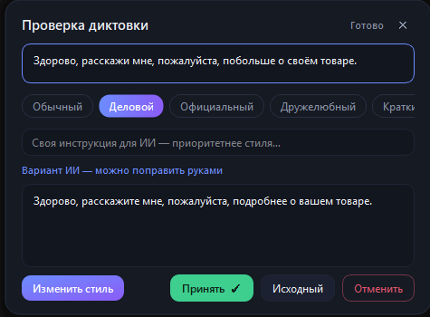
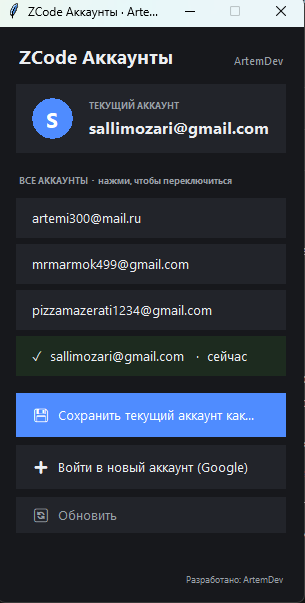
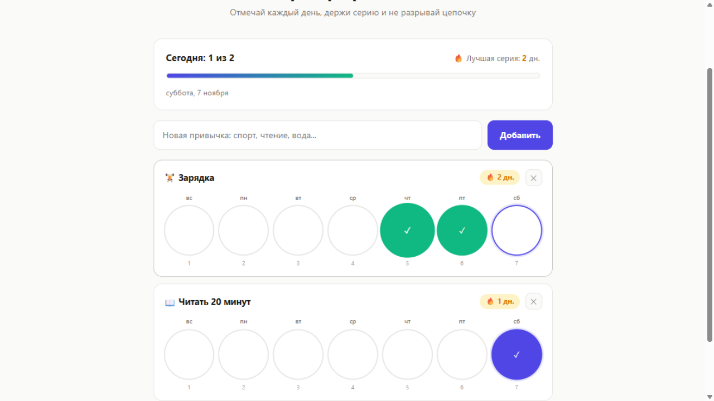
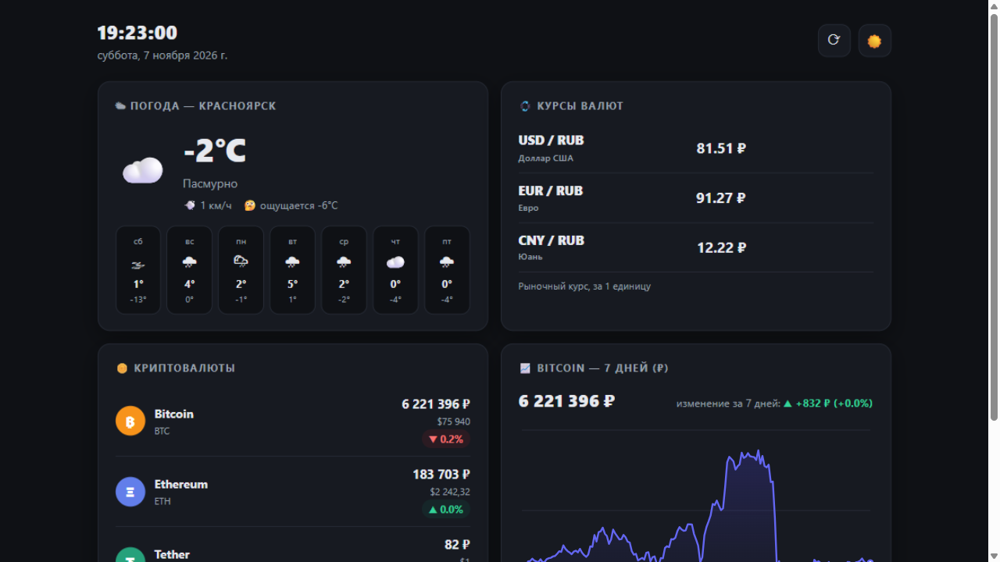

# 👨‍💻 Портфолио — Артём

Привет! Я Артём ([@ArtemDev-Krs](https://github.com/ArtemDev-Krs)). Пишу Telegram-ботов и утилиты, делаю сайты. Здесь собираю свои проекты — коротко и по делу.

---

##  Speak to Text — голосовой ввод с ИИ *(в разработке)*

**Windows-утилита голосового ввода с ИИ-редактированием: говоришь в микрофон — речь превращается в текст прямо в любом приложении, а LLM тут же предлагает улучшить формулировку.**

- ⌨️ Alt+V в любом приложении — речь потоково печатается в активное поле
- 🧠 ИИ-редактура после диктовки: исправление ошибок, деловой/дружелюбный стиль, своя инструкция
- ⚡ Распознавание локально: faster-whisper (large-v3-turbo на CUDA)
- 🔌 LLM через OpenAI-совместимый API — LM Studio локально или облако
- 📦 Упаковано в standalone-приложение

**Стек:** Python · PySide6 · faster-whisper · OpenAI-совместимый API

**Код:** [репозиторий](https://github.com/ArtemDev-Krs/speak-to-text) · [релиз v0.1.0](https://github.com/ArtemDev-Krs/speak-to-text/releases/tag/v0.1.0)

**Скриншоты:**

| Индикатор записи | ИИ-редактура диктовки |
|:---:|:---:|
|  |  |

---

## 🤖 Lzt_bot — автовыкуп лотов на lzt.market

**Telegram-бот, который мониторит LolzTeam Market и сам выкупает лоты по заданному ценовому лимиту.** Все отчёты присылает прямо в Telegram.

**Что умеет:**

- 🛒 Автовыкуп лотов по ценовому лимиту — работает даже ночью
- 💰 Следит за балансом и показывает, на сколько покупок его хватит
- 📊 Статистика: сколько куплено, средняя цена, топ продавцов
- ⏰ Аналитика по времени: в какие часы чаще появляются лоты и проходят покупки
- ✅ По каждой покупке — карточка с лотом, ценой, продавцом и данными аккаунта
- ⚠️ Если выкупить не удалось — тоже сообщит

**Скриншоты работы:**

| Статистика и баланс | Отчёт о покупке |
|:---:|:---:|
|  |  |

---

## 🧰 Утилиты

### [ZCode Аккаунты](https://github.com/ArtemDev-Krs/zcode-accounts) — переключатель аккаунтов ZCode

**Windows-утилита: несколько аккаунтов ZCode и переключение между ними в один клик.**

- 🔀 Клик по аккаунту — ZCode сам закрывается, переключается и открывается уже вошедшим в него, без ручных «выйти / войти через Google»
- 👤 Карточка текущего аккаунта и список всех сохранённых аккаунтов
- 💾 Сохранение текущего аккаунта под именем, вход в новый аккаунт через Google
- 🔐 Снимки сессий шифруются (AES-GCM), токены автообновляются при каждом переключении
- 📦 Автономный exe без установки — [скачать v1.0](https://github.com/ArtemDev-Krs/zcode-accounts/releases/latest)

**Скриншот:**

---

### [Habit Tracker](https://github.com/ArtemDev-Krs/habit-tracker) — трекер привычек

**Мини-веб-приложение: отмечай привычки каждый день, держи серию 🔥 и не разрывай цепочку.**

- 📅 Отметки за последние 7 дней в один клик
- 🔥 Серии дней: сегодня не отметил — серия не сломана
- 📊 Сводка за день: прогресс-бар и лучшая серия
- 💾 Данные хранятся в браузере (localStorage) — без аккаунтов и серверов
- 🎉 Конфетти, когда все привычки на сегодня выполнены

**Скриншот:**

**Онлайн:** [открыть трекер](https://artemdev-krs.github.io/habit-tracker/)

---

## 🌐 Сайты

### [Blade & Co.](https://github.com/ArtemDev-Krs/barber-demo) — лендинг барбершопа

Одностраничник на чистых HTML/CSS/JS: скролл-анимации, параллакс-эффекты, кастомный курсор, поддержка `prefers-reduced-motion`. Портфолиный проект.

---

### [Dashboard](https://github.com/ArtemDev-Krs/dashboard) — живой дашборд

**Дашборд с реальными данными: погода Красноярска, курсы валют, крипта и график Bitcoin — всё без API-ключей.**

- 🌤 Погода Красноярска на 7 дней (Open-Meteo)
- 💱 Курсы USD / EUR / CNY со стрелками изменения за день
- 🪙 Bitcoin, Ethereum, Tether — в рублях и долларах
- 📈 График BTC/RUB за 7 дней, нарисованный на canvas
- 🌙 Тёмная и светлая темы, живые часы

**Скриншот:**

**Онлайн:** [открыть дашборд](https://artemdev-krs.github.io/dashboard/)

---
*Раздел пополняется — новые проекты на подходе 🚀*
