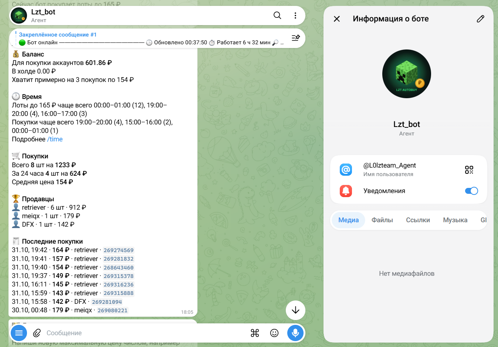
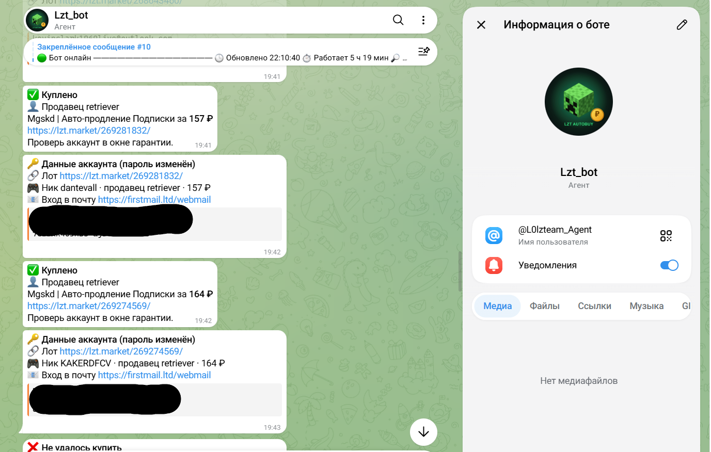
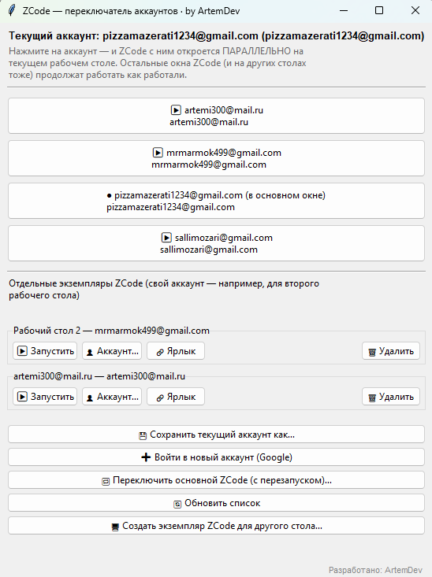

# 👨‍💻 Портфолио — Артём

Привет! Я Артём ([@ArtemDev-Krs](https://github.com/ArtemDev-Krs)). Пишу Telegram-ботов и утилиты, делаю сайты. Здесь собираю свои проекты — коротко и по делу.

---

##  Speak to Text — голосовой ввод с ИИ *(в разработке)*

**Windows-утилита голосового ввода с ИИ-редактированием: говоришь в микрофон — речь превращается в текст прямо в любом приложении, а LLM тут же предлагает улучшить формулировку.**

- ⌨️ Alt+V в любом приложении — речь потоково печатается в активное поле
- 🧠 ИИ-редактура после диктовки: исправление ошибок, деловой/дружелюбный стиль, своя инструкция
- ⚡ Распознавание локально: faster-whisper (large-v3-turbo на CUDA)
- 🔌 LLM через OpenAI-совместимый API — LM Studio локально или облако
- 📦 Упаковано в standalone-приложение

**Стек:** Python · PySide6 · faster-whisper · OpenAI-совместимый API

---

## 🤖 Lzt_bot — автовыкуп лотов на lzt.market

**Telegram-бот, который мониторит LolzTeam Market и сам выкупает лоты по заданному ценовому лимиту.** Все отчёты присылает прямо в Telegram.

**Что умеет:**

- 🛒 Автовыкуп лотов по ценовому лимиту — работает даже ночью
- 💰 Следит за балансом и показывает, на сколько покупок его хватит
- 📊 Статистика: сколько куплено, средняя цена, топ продавцов
- ⏰ Аналитика по времени: в какие часы чаще появляются лоты и проходят покупки
- ✅ По каждой покупке — карточка с лотом, ценой, продавцом и данными аккаунта
- ⚠️ Если выкупить не удалось — тоже сообщит

**Скриншоты работы:**

| Статистика и баланс | Отчёт о покупке |
|:---:|:---:|
|  |  |

---

## 🧰 Утилиты

### ZCode Switcher — переключатель аккаунтов

**Утилита для Windows, которая держит несколько аккаунтов ZCode и запускает их параллельно — не трогая уже открытые окна.**

- 🔀 Клик по аккаунту — ZCode открывается с ним на текущем столе, а остальные окна (даже на других столах) продолжают работать как работали
- 🖥️ Отдельные экземпляры ZCode под каждый рабочий стол — например, свой аккаунт на втором
- 💾 Сохранение текущего аккаунта, вход в новый Google-аккаунт, ярлыки под отдельные экземпляры
- 🔄 Переключение основного ZCode с перезапуском

**Скриншот:**

---

## 🌐 Сайты

### [Blade & Co.](https://github.com/ArtemDev-Krs/barber-demo) — лендинг барбершопа

Одностраничник на чистых HTML/CSS/JS: скролл-анимации, параллакс-эффекты, кастомный курсор, поддержка `prefers-reduced-motion`. Портфолиный проект.

---

*Раздел пополняется — новые проекты на подходе 🚀*
